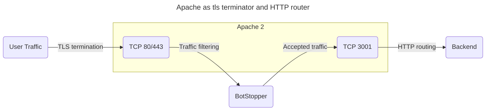

# Apache

Apache terminates TLS, sends requests through BotStopper, and receives accepted requests on a separate HTTP listener.



The final Apache listener routes requests to your websites or application backends.

These examples use separate configuration files in `/etc/httpd/conf.d/`.
If your deployment uses one configuration file, add the snippets to `/etc/httpd/conf/httpd.conf`.

## Configuration

For `anubistest.techaro.lol`, create three virtual hosts:

1. A block on port 80 that forwards HTTP to HTTPS
2. A block on port 443 that terminates TLS and forwards to BotStopper
3. A block on port 3001 that serves your websites

```text
# Plain HTTP redirect to HTTPS
<VirtualHost *:80>
       ServerAdmin your@email.here
       ServerName anubistest.techaro.lol
       DocumentRoot /var/www/anubistest.techaro.lol
       ErrorLog /var/log/httpd/anubistest.techaro.lol_error.log
       CustomLog /var/log/httpd/anubistest.techaro.lol_access.log combined
       RewriteEngine on
       RewriteCond %{SERVER_NAME} =anubistest.techaro.lol
       RewriteRule ^ https://%{SERVER_NAME}%{REQUEST_URI} [END,NE,R=permanent]
</VirtualHost>

# HTTPS listener that forwards to BotStopper
<IfModule mod_proxy.c>
<VirtualHost *:443>
       ServerAdmin your@email.here
       ServerName anubistest.techaro.lol
       DocumentRoot /var/www/anubistest.techaro.lol
       ErrorLog /var/log/httpd/anubistest.techaro.lol_error.log
       CustomLog /var/log/httpd/anubistest.techaro.lol_access.log combined

       SSLCertificateFile /etc/letsencrypt/live/anubistest.techaro.lol/fullchain.pem
       SSLCertificateKeyFile /etc/letsencrypt/live/anubistest.techaro.lol/privkey.pem
       Include /etc/letsencrypt/options-ssl-apache.conf

       # These headers need to be set or else BotStopper will
       # throw an "admin misconfiguration" error.
       RequestHeader set "X-Real-IP" expr=%{REMOTE_ADDR}
       RequestHeader set X-Forwarded-Proto "https"
       RequestHeader set "X-Http-Version" "%{SERVER_PROTOCOL}s"
       RequestHeader set "X-TLS-SNI-Name" "%{SSL_TLS_SNI}s"

       ProxyPreserveHost On

       ProxyRequests Off
       ProxyVia Off

       # Replace 9000 with the port BotStopper listens on
       ProxyPass / http://[::1]:9000/
       ProxyPassReverse / http://[::1]:9000/
</VirtualHost>
</IfModule>

# Actual website config
<VirtualHost *:3001>
       ServerAdmin your@email.here
       ServerName anubistest.techaro.lol
       DocumentRoot /var/www/anubistest.techaro.lol
       ErrorLog /var/log/httpd/anubistest.techaro.lol_error.log
       CustomLog /var/log/httpd/anubistest.techaro.lol_access.log combined

       # Pass the remote IP to the proxied application instead of 127.0.0.1
       # This requires mod_remoteip
       RemoteIPHeader X-Real-IP
       RemoteIPTrustedProxy 127.0.0.1/32
</VirtualHost>
```

Add a configuration file for the listener on port 3001:

```text
# /etc/httpd/conf.d/listener-3001.conf

Listen [::1]:3001
```

For an IPv4-only system, use this listener instead:

```text
# /etc/httpd/conf.d/listener-3001.conf

Listen 127.0.0.1:3001
```

For IPv4-only deployments, also change both proxy URLs to `http://127.0.0.1:9000/`.
Match the BotStopper `BIND` and `TARGET` addresses to the selected listeners.

The backend uses `mod_remoteip` to restore the client address from `X-Real-IP`.
If BotStopper connects through IPv6, also add `RemoteIPTrustedProxy ::1/128`.
See [client IP configuration](/docs/configuration/client-ip.md) for trusted proxy headers.

One BotStopper instance can serve multiple sites.
Apache uses the preserved `Host` header to select the backend virtual host.

Install the service through [native installation](/docs/installation/native-install.md).
Configure its listener on port 9000 and its target on port 3001.

Reload Apache, then open the protected website:

```text
sudo systemctl reload httpd.service
```

## Troubleshooting

### Service unavailable on Red Hat distributions

SELinux can prevent Apache from opening the connection to BotStopper on Red Hat distributions.
If every page returns "Service unavailable", inspect the journal for this guidance:

```text
*****  Plugin catchall_boolean (89.3 confidence) suggests   ******************

If you want to allow HTTPD scripts and modules to connect to the network using TCP.
Then you must tell SELinux about this by enabling the 'httpd_can_network_connect' boolean.

Do
setsebool -P httpd_can_network_connect 1
```

The `httpd_can_network_connect` boolean permits Apache to open TCP connections to the proxy.
