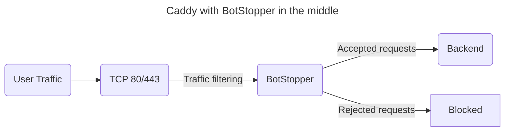

# Caddy

Place BotStopper between Caddy and your backend. Caddy terminates TLS, then sends requests to BotStopper for filtering:



BotStopper forwards accepted requests to the backend and blocks rejected requests.

## Registry access

The BotStopper image requires GitHub Container Registry credentials with permission to pull the package. Authenticate before you start Compose:

```text
docker login ghcr.io -u your-username --password-stdin
```

Supply your access token on standard input. Refer to [installation](/docs/installation.md) for registry authentication details.

## Docker Compose configuration

Create `compose.yml` with these services:

```yaml
services:
  caddy:
    image: caddy:2
    ports:
      - 80:80
      - 443:443
      - 443:443/udp
    volumes:
      - ./conf:/etc/caddy
      - caddy_config:/config
      - caddy_data:/data

  anubis:
    image: ghcr.io/techarohq/botstopper/anubis:latest
    pull_policy: always
    environment:
      BIND: ":3000"
      TARGET: http://httpdebug:3000

  httpdebug:
    image: ghcr.io/xe/x/httpdebug
    pull_policy: always

volumes:
  caddy_data:
  caddy_config:
```

Create `conf/Caddyfile`:

```text
# conf/Caddyfile

yourdomain.example.com {
  tls your@email.address

  reverse_proxy http://anubis:3000 {
    header_up X-Real-IP {remote_host}
    header_up X-Http-Version {http.request.proto}
    header_up X-TLS-SNI-Name {tls_server_name}
  }
}
```

## Multiple services

To protect multiple services, run one BotStopper instance for each backend. You can also use two Caddy instances. The first terminates TLS and forwards requests through BotStopper. The second routes accepted requests to the backends.

Refer to [Nginx](/docs/installation/nginx.md) or [Apache](/docs/installation/apache.md) for similar routing configurations.

For clients behind Cloudflare, use the [Cloudflare configuration](/docs/installation/cloudflare.md) to preserve the client address.

Next, read [configuration](/docs/configuration.md) and [policy definitions](/docs/policies.md).
