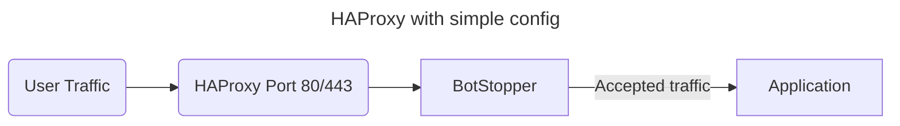
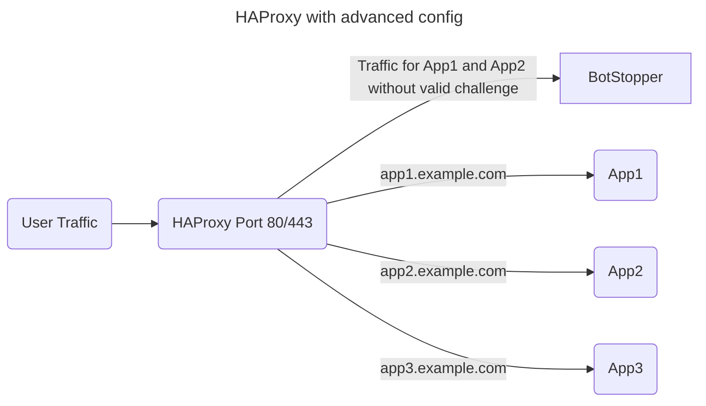

# HAProxy

HAProxy supports two integration patterns:

- Simple: HAProxy sends requests to BotStopper, which forwards accepted traffic to one application.
- Advanced: HAProxy validates the authorization token and routes accepted requests to several application backends.

The advanced pattern uses HAProxy ACLs to select protected domains and paths.
HAProxy 3.0 or later improves JWT decoding performance.

## Simple configuration



Create the BotStopper instance configuration:

```bash
# /etc/techaro-botstopper/default.env

BIND=/run/techaro-botstopper/default/default.sock
BIND_NETWORK=unix
SOCKET_MODE=0666
DIFFICULTY=4
METRICS_BIND=:9090
COOKIE_DYNAMIC_DOMAIN=true
# address and port of the actual application
TARGET=http://localhost:3000
```

`TARGET` points to your application.
If HAProxy and BotStopper run on the same machine, they can communicate through a Unix socket.
The packaged service creates `/run/techaro-botstopper/default/` for the `default` instance.
The socket mode permits HAProxy to connect to this socket.
See [native installation](/docs/installation/native-install.md) for package installation and instance configuration.

Configure the HAProxy frontend and backend:

```haproxy
# /etc/haproxy/haproxy.cfg

frontend FE-application
  mode http
  bind :80
  # ssl offloading on port 443 using a certificate from /etc/haproxy/ssl/ directory
  bind :443 ssl crt /etc/haproxy/ssl/ alpn h2,http/1.1 ssl-min-ver TLSv1.2 no-tls-tickets

  # set X-Real-IP header required for BotStopper
  http-request set-header X-Real-IP "%[src]"
  # set TLS SNI name for BotStopper
  http-request set-header X-TLS-SNI-Name %[ssl_fc_sni]

  # redirect HTTP to HTTPS
  http-request redirect scheme https code 301 unless { ssl_fc }
  # add HSTS header
  http-response set-header Strict-Transport-Security "max-age=31536000; includeSubDomains; preload"

  # route to BotStopper backend by default
  default_backend BE-anubis-application

backend BE-anubis-application
  mode http
  server anubis /run/techaro-botstopper/default/default.sock
```

HAProxy terminates TLS, sets the proxy headers, and sends traffic to BotStopper.
See [client IP configuration](/docs/configuration/client-ip.md) for the `X-Real-IP` header.

Start the instance:

```shell
sudo systemctl enable --now techaro-botstopper@default.service
```

## Advanced configuration

HAProxy can decode and validate the JWT authorization token from BotStopper.
After validation, HAProxy routes requests directly to the application backends.

HAProxy handles exceptions for Git HTTP and other permitted bot traffic in this pattern.
Define those exceptions with `acl_anubis_ignore`.
The [BotStopper policy](/docs/policies.md) in this example challenges every request that HAProxy sends to it.

This example has three applications behind one HAProxy frontend.
BotStopper protects App1 and App2.
App3 and `/excluded/path` allow access without a challenge.



Create the BotStopper instance configuration:

```bash
# /etc/techaro-botstopper/default.env

BIND=/run/techaro-botstopper/default/default.sock
BIND_NETWORK=unix
SOCKET_MODE=0666
DIFFICULTY=4
METRICS_BIND=:9090
# target is irrelevant here, backend routing happens in HAProxy
TARGET=http://0.0.0.0
HS512_SECRET=<SECRET-HERE>
COOKIE_DYNAMIC_DOMAIN=true
POLICY_FNAME=/etc/techaro-botstopper/challenge-any.yml
DYNAMIC_COOKIE_SUFFIX=false
```

Use `HS512_SECRET` for a signing algorithm that HAProxy supports.
Replace `<SECRET-HERE>` with a secret string.
The upstream example recommends 128 alphanumeric characters.
Set `DYNAMIC_COOKIE_SUFFIX=false` so HAProxy can read a fixed cookie name.
If you change `COOKIE_PREFIX`, also change every cookie reference in the HAProxy configuration.

Create a policy that challenges every request:

```yaml
# /etc/techaro-botstopper/challenge-any.yml

bots:
  - name: any
    action: CHALLENGE
    expression: "true"

status_codes:
  CHALLENGE: 403
  DENY: 403

thresholds: []

dnsbl: false
```

Configure HAProxy to validate the token and select the application backend:

```haproxy
# /etc/haproxy/haproxy.cfg

frontend FE-multiple-applications
  mode http
  bind :80
  # ssl offloading on port 443 using a certificate from /etc/haproxy/ssl/ directory
  bind :443 ssl crt /etc/haproxy/ssl/ alpn h2,http/1.1 ssl-min-ver TLSv1.2 no-tls-tickets

  # set X-Real-IP header required for BotStopper
  http-request set-header X-Real-IP "%[src]"
  # set TLS SNI name for BotStopper
  http-request set-header X-TLS-SNI-Name %[ssl_fc_sni]

  # redirect HTTP to HTTPS
  http-request redirect scheme https code 301 unless { ssl_fc }
  # add HSTS header
  http-response set-header Strict-Transport-Security "max-age=31536000; includeSubDomains; preload"

  # only force BotStopper challenge for app1 and app2
  acl acl_anubis_required hdr(host) -i "app1.example.com"
  acl acl_anubis_required hdr(host) -i "app2.example.com"

  # exclude BotStopper for a specific path
  acl acl_anubis_ignore path /excluded/path

  # use BotStopper if auth cookie not found
  use_backend BE-anubis if acl_anubis_required !acl_anubis_ignore !{ req.cook(techaro.lol-anubis-auth) -m found }

  # get payload of the JWT such as algorithm, expire time, restrictions
  http-request set-var(txn.anubis_jwt_alg) req.cook(techaro.lol-anubis-auth),jwt_header_query('$.alg') if acl_anubis_required !acl_anubis_ignore
  http-request set-var(txn.anubis_jwt_exp) cook(techaro.lol-anubis-auth),jwt_payload_query('$.exp','int') if acl_anubis_required !acl_anubis_ignore
  http-request set-var(txn.anubis_jwt_res) cook(techaro.lol-anubis-auth),jwt_payload_query('$.restriction') if acl_anubis_required !acl_anubis_ignore
  http-request set-var(txn.srcip) req.fhdr(X-Real-IP) if acl_anubis_required !acl_anubis_ignore
  http-request set-var(txn.now) date() if acl_anubis_required !acl_anubis_ignore

  # use BotStopper if JWT has wrong algorithm, is expired, restrictions don't match or isn't signed with the correct key
  use_backend BE-anubis if acl_anubis_required !acl_anubis_ignore !{ var(txn.anubis_jwt_alg) -m str HS512 }
  use_backend BE-anubis if acl_anubis_required !acl_anubis_ignore { var(txn.anubis_jwt_exp),sub(txn.now) -m int lt 0 }
  use_backend BE-anubis if acl_anubis_required !acl_anubis_ignore !{ var(txn.srcip),digest(sha256),hex,lower,strcmp(txn.anubis_jwt_res) eq 0 }
  use_backend BE-anubis if acl_anubis_required !acl_anubis_ignore !{ cook(techaro.lol-anubis-auth),jwt_verify(txn.anubis_jwt_alg,"<SECRET-HERE>") -m int 1 }

  # everything below this line is for good traffic only
  # custom routing in HAProxy
  use_backend BE-app1 if { hdr(host) -i "app1.example.com" }
  use_backend BE-app2 if { hdr(host) -i "app2.example.com" }
  use_backend BE-app3 if { hdr(host) -i "app3.example.com" }

backend BE-app1
  mode http
  server app1-server 127.0.0.1:3000

backend BE-app2
  mode http
  server app2-server 127.0.0.1:4000

backend BE-app3
  mode http
  server app3-server 127.0.0.1:5000

backend BE-anubis
  mode http
  server anubis /run/techaro-botstopper/default/default.sock
```

Replace `<SECRET-HERE>` with the same secret as `HS512_SECRET` in the BotStopper configuration.
The restriction check expects the token to bind to `X-Real-IP`, the default restriction header.
If you change that header, adapt the HAProxy restriction check to match.

Reload HAProxy after you install the configuration:

```shell
sudo systemctl reload haproxy.service
```
