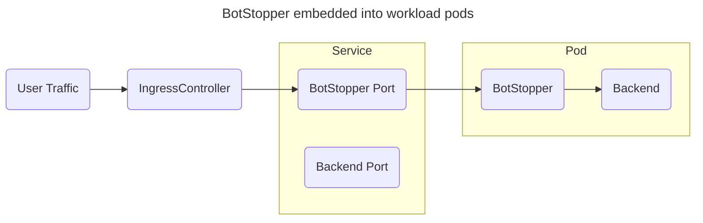

# Kubernetes

> **Note.**
> Leave the `PUBLIC_URL` environment variable unset in this sidecar/standalone setup. Setting it here makes redirect construction fail (`redir=null`).

Route ingress traffic through BotStopper before it reaches the application:



Run BotStopper as a sidecar in each application pod, as shown here.
Anubis integrations such as [ingress-anubis](https://github.com/jaredallard/ingress-anubis) and [anubis-kubernetes-operator](https://github.com/eznix86/anubis-kubernetes-operator) provide other deployment approaches.
For those integrations, configure the BotStopper image and registry credentials.

This example makes the following assumptions:

- Your target service is listening on TCP port `5000`.
- BotStopper will be listening on port `8080`.

Adjust the ports to match your application.

## Registry credentials

Create the image pull secret in the same namespace as your Deployment.
Use a GitHub token with access to the BotStopper container package:

```sh
kubectl create secret docker-registry techarohq-botstopper \
  --namespace default \
  --docker-server=ghcr.io \
  --docker-username=your-username \
  --docker-password=your-access-token \
  --docker-email=your@email.address
```

Attach the secret to the pod template in your Deployment:

```yaml
spec:
  template:
    spec:
      imagePullSecrets:
        - name: techarohq-botstopper
```

## Signing key and sidecar

Generate a random 32-byte Ed25519 signing seed and store it in a Kubernetes Secret:

```
kubectl create secret generic botstopper-key \
  --namespace default \
  --from-literal=ED25519_PRIVATE_KEY_HEX=$(openssl rand -hex 32)
```

Attach BotStopper to your Deployment:

```yaml
containers:
  # ...
  - name: botstopper
    image: ghcr.io/techarohq/botstopper/anubis:latest
    imagePullPolicy: Always
    env:
      - name: "BIND"
        value: ":8080"
      - name: "POLICY_FNAME"
        value: "/data/cfg/botPolicy.yaml"
      - name: ED25519_PRIVATE_KEY_HEX
        valueFrom:
          secretKeyRef:
            name: botstopper-key
            key: ED25519_PRIVATE_KEY_HEX
      - name: "METRICS_BIND"
        value: ":9090"
      - name: "SERVE_ROBOTS_TXT"
        value: "true"
      - name: "TARGET"
        value: "http://localhost:5000"
      - name: "OG_PASSTHROUGH"
        value: "true"
      - name: "OG_EXPIRY_TIME"
        value: "24h"
    volumeMounts:
      - name: bot-policy
        mountPath: /data/cfg
        readOnly: true
    resources:
      limits:
        cpu: 750m
        memory: 256Mi
      requests:
        cpu: 250m
        memory: 256Mi
    securityContext:
      runAsUser: 1000
      runAsGroup: 1000
      runAsNonRoot: true
      allowPrivilegeEscalation: false
      capabilities:
        drop:
          - ALL
      seccompProfile:
        type: RuntimeDefault
```

Set challenge difficulty in the [policy file](/docs/policies.md), under the challenge or threshold configuration.
The sidecar reads `/data/cfg/botPolicy.yaml`. Create a ConfigMap from your policy file and mount it in the pod:

```
kubectl create configmap bot-policy \
  --namespace default \
  --from-file=botPolicy.yaml=./botPolicy.yaml
```

```yaml
volumes:
  - name: bot-policy
    configMap:
      name: bot-policy
```

Then add a Service entry for BotStopper:

```yaml
# ...
spec:
  ports:
    - protocol: TCP
      port: 8080
      targetPort: 8080
      name: botstopper
```

Then point your Ingress to the BotStopper port:

```yaml
rules:
  - host: git.xeserv.us
    http:
      paths:
        - pathType: Prefix
          path: "/"
          backend:
            service:
              name: git
              port:
                name: botstopper
```

## Envoy Gateway

If you are using envoy-gateway, the `X-Real-IP` header is not set by default, but BotStopper does require it. You can resolve this by adding the header, either on the specific `HTTPRoute` where BotStopper is listening, or on the `ClientTrafficPolicy` to apply it to any number of Gateways:

HTTPRoute:

```yaml
apiVersion: gateway.networking.k8s.io/v1
kind: HTTPRoute
metadata:
  name: app-route
spec:
  hostnames: ["app.domain.tld"]
  parentRefs:
    - name: envoy-external
      namespace: network
      sectionName: https
  rules:
    - backendRefs:
        - name: app
          port: 8080
      filters:
        - type: RequestHeaderModifier
          requestHeaderModifier:
            set:
              - name: X-Real-IP
                value: "%DOWNSTREAM_REMOTE_ADDRESS_WITHOUT_PORT%"
```

Applying to any number of Gateways:

```yaml
apiVersion: gateway.envoyproxy.io/v1alpha1
kind: ClientTrafficPolicy
metadata:
  name: envoy
spec:
  headers:
    earlyRequestHeaders:
      set:
        - name: X-Real-IP
          value: "%DOWNSTREAM_REMOTE_ADDRESS_WITHOUT_PORT%"
  clientIPDetection:
    xForwardedFor:
      trustedCIDRs:
        - 10.96.0.0/16 # Cluster pod CIDR
  targetSelectors: # These will apply to all Gateways
    - group: gateway.networking.k8s.io
      kind: Gateway
```

See [client IP headers](/docs/configuration/client-ip.md) when the ingress uses multiple proxy hops.
See [configuration](/docs/configuration.md) for policy and challenge configuration.
