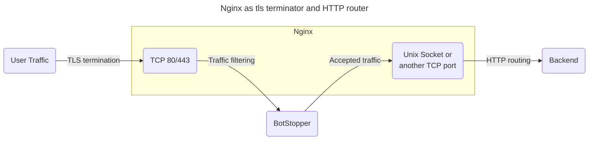

# Nginx

Nginx terminates TLS, sends requests through BotStopper, and receives accepted requests on a separate socket.



BotStopper filters traffic before Nginx routes requests to the individual virtual hosts.
The backend listener can use a Unix socket or a separate TCP port.
This arrangement also supports a backend such as Apache for an existing deployment.

Configure [TLS certificates](https://code.kuederle.com/letsencrypt/) on the public listener.
These examples use separate configuration files in `/etc/nginx/conf.d/`.
If your deployment uses one configuration file, add the snippets inside the HTTP section of `/etc/nginx/nginx.conf`.

## Server configuration

For `anubistest.techaro.lol`, use this server configuration:

```nginx
# /etc/nginx/conf.d/server-anubistest-techaro-lol.conf

# HTTP - Redirect all HTTP traffic to HTTPS
server {
  listen 80;
  listen [::]:80;

  server_name anubistest.techaro.lol;

  location / {
    return 301 https://$host$request_uri;
  }
}

# TLS termination server, this will listen over TLS (https) and then
# proxy all traffic to the target via BotStopper.
server {
  # Listen on TCP port 443 with TLS (https) and HTTP/2
  listen 443 ssl;
  listen [::]:443 ssl;
  http2 on;

  location / {
    proxy_set_header Host $host;
    proxy_set_header X-Real-IP $remote_addr;
    proxy_set_header X-Http-Version $server_protocol;
    proxy_set_header X-TLS-SNI-Name $ssl_server_name;
    proxy_pass http://anubis;
  }

  server_name anubistest.techaro.lol;

  ssl_certificate /path/to/your/certs/anubistest.techaro.lol.crt;
  ssl_certificate_key /path/to/your/certs/anubistest.techaro.lol.key;
}

# Backend server, this is where your webapp should actually live.
server {
  listen unix:/run/nginx/nginx.sock;

  server_name anubistest.techaro.lol;
  root "/srv/http/anubistest.techaro.lol";
  index index.html;

  # Get the visiting IP from the TLS termination server
  set_real_ip_from unix:;
  real_ip_header X-Real-IP;

  # Your normal configuration can go here
  # location .php { fastcgi...} etc.
}
```

## Reusable proxy block

Copy the proxy block into `/etc/nginx/conf-anubis.inc` to reuse it across server blocks:

```nginx
# /etc/nginx/conf-anubis.inc

# Forward to anubis
location / {
  proxy_set_header Host $host;
  proxy_set_header X-Real-IP $remote_addr;
  proxy_set_header X-Http-Version $server_protocol;
  proxy_set_header X-TLS-SNI-Name $ssl_server_name;
  proxy_pass http://anubis;
}
```

Include this file from another server block:

```nginx
# /etc/nginx/conf.d/server-mimi-techaro-lol.conf

server {
  # Listen on 443 with SSL
  listen 443 ssl;
  listen [::]:443 ssl;
  http2 on;

  # Slipstream via BotStopper
  include "conf-anubis.inc";

  server_name mimi.techaro.lol;

  ssl_certificate /path/to/your/certs/mimi.techaro.lol.crt;
  ssl_certificate_key /path/to/your/certs/mimi.techaro.lol.key;
}

server {
  listen unix:/run/nginx/nginx.sock;

  server_name mimi.techaro.lol;

  port_in_redirect off;
  root "/srv/http/mimi.techaro.lol";
  index index.html;

  # Your normal configuration can go here
  # location .php { fastcgi...} etc.
}
```

## BotStopper upstream

Create an upstream for BotStopper:

```nginx
# /etc/nginx/conf.d/upstream-anubis.conf

upstream anubis {
  # Make sure this matches the values you set for `BIND` and `BIND_NETWORK`.
  # If this does not match, your services will not be protected by BotStopper.

  # Try anubis first over a UNIX socket
  server unix:/run/techaro-botstopper/nginx/nginx.sock;
  #server 127.0.0.1:8923;

  # Optional: fall back to serving the websites directly. This allows your
  # websites to be resilient against BotStopper failing, at the risk of exposing
  # them to the raw internet without protection. This is a tradeoff and can
  # be worth it in some edge cases.
  #server unix:/run/nginx/nginx.sock backup;
}
```

The upstream alias `anubis` must match each `proxy_pass` directive.
It is a Nginx configuration name.

Install BotStopper through [native installation](/docs/installation/native-install.md).
For the Unix socket example, create this instance configuration:

```bash
# /etc/techaro-botstopper/nginx.env

BIND=/run/techaro-botstopper/nginx/nginx.sock
BIND_NETWORK=unix
SOCKET_MODE=0666
TARGET=unix:///run/nginx/nginx.sock
```

The packaged service creates `/run/techaro-botstopper/nginx/` for the `nginx` instance.
The socket mode permits Nginx to connect to the service socket.
BotStopper must also have permission to connect to the Nginx backend socket.

Start the instance:

```shell
sudo systemctl enable --now techaro-botstopper@nginx.service
```

For a TCP connection, use the commented `127.0.0.1:8923` upstream.
Set `BIND` to the same address and set `BIND_NETWORK=tcp`.

One BotStopper instance can serve multiple sites.
Nginx uses the preserved `Host` header to select each backend virtual host.
See [client IP configuration](/docs/configuration/client-ip.md) for trusted proxy headers.

Reload Nginx, then open the protected website:

```text
sudo systemctl reload nginx.service
```
