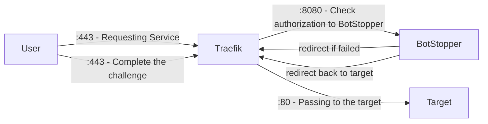

# Traefik

This guide uses Docker Compose. The same configuration also applies to containers started with the Docker CLI.

The deployment contains four containers:

- `traefik`: The Traefik proxy.
- `anubis`: BotStopper, used for authorization and browser challenges.
- `target`: The protected service, using `traefik/whoami`.
- `target2`: A service without BotStopper protection, also using `traefik/whoami`.

## Registry access

The BotStopper image requires GitHub Container Registry credentials with permission to pull the package. Authenticate before you start Compose:

```text
docker login ghcr.io -u your-username --password-stdin
```

Supply your access token on standard input. Refer to [installation](/docs/installation.md) for registry authentication details.

## Request flow

The container ports depend on each service. This example uses port 8080 for BotStopper and port 80 for the protected backend.



## Policy configuration

Create `botPolicy.yaml` from your [policy definitions](/docs/policies.md). Set the denial status to `403` so Traefik does not accept a denied request as successful authorization:

```yaml
status_codes:
  CHALLENGE: 200
  DENY: 403
```

## Compose configuration

Replace the example domain names and certificate email with your own values. The `anubis.example.com` hostname serves BotStopper's challenge page.

Create `compose.yml`:

```yml
services:
  traefik:
    image: traefik:v3.3
    ports:
      - 80:80
      - 443:443
    volumes:
      - /var/run/docker.sock:/var/run/docker.sock
      - ./letsencrypt:/letsencrypt
      - ./traefik.yml:/traefik.yml:ro
    networks:
      - traefik
    labels:
      # Enable Traefik
      - traefik.enable=true
      - traefik.docker.network=traefik
      # BotStopper middleware
      - traefik.http.middlewares.anubis.forwardauth.address=http://anubis:8080/.within.website/x/cmd/anubis/api/check
      # Redirect any HTTP to HTTPS
      - traefik.http.middlewares.redirect-to-https.redirectscheme.scheme=https
      - traefik.http.routers.web.rule=PathPrefix(`/`)
      - traefik.http.routers.web.entrypoints=web
      - traefik.http.routers.web.middlewares=redirect-to-https
      - traefik.http.routers.web.tls=false

  anubis:
    image: ghcr.io/techarohq/botstopper/anubis:latest
    environment:
      # Listen for Traefik on port 8080
      - BIND=:8080
      # Disable backend proxying; preserve the space after '='
      - "TARGET= "
      # Specifies which domains BotStopper is allowed to redirect to.
      - REDIRECT_DOMAINS=example.com
      # Full external URL for BotStopper, including the scheme
      - PUBLIC_URL=https://anubis.example.com
      # Domain shared by the protected site and challenge page
      - COOKIE_DOMAIN=example.com
      - POLICY_FNAME=/etc/techaro-botstopper/botPolicy.yaml
    volumes:
      - ./botPolicy.yaml:/etc/techaro-botstopper/botPolicy.yaml:ro
    networks:
      - traefik
    labels:
      - traefik.enable=true # Enabling Traefik
      - traefik.docker.network=traefik # Telling Traefik which network to use
      - traefik.http.routers.anubis.rule=Host(`anubis.example.com`) # Match this service hostname
      - traefik.http.routers.anubis.entrypoints=websecure # Listen on HTTPS
      - traefik.http.services.anubis.loadbalancer.server.port=8080 # Telling Traefik where to receive requests
      - traefik.http.routers.anubis.service=anubis # Telling Traefik to use the above specified port
      - traefik.http.routers.anubis.tls.certresolver=le # Telling Traefik to resolve a Cert for BotStopper

  # Protected by BotStopper
  target:
    image: traefik/whoami:latest
    networks:
      - traefik
    labels:
      - traefik.enable=true # Enabling Traefik
      - traefik.docker.network=traefik # Telling Traefik which network to use
      - traefik.http.routers.target.rule=Host(`example.com`) # Match this service hostname
      - traefik.http.routers.target.entrypoints=websecure # Listen on the HTTPS entry point
      - traefik.http.services.target.loadbalancer.server.port=80 # Telling Traefik where to receive requests
      - traefik.http.routers.target.service=target # Telling Traefik to use the above specified port
      - traefik.http.routers.target.tls.certresolver=le # Telling Traefik to resolve a Cert for BotStopper
      - traefik.http.routers.target.middlewares=anubis@docker # Use the BotStopper middleware

  # Not Protected by BotStopper
  target2:
    image: traefik/whoami:latest
    networks:
      - traefik
    labels:
      - traefik.enable=true # Enabling Traefik
      - traefik.docker.network=traefik # Telling Traefik which network to use
      - traefik.http.routers.target2.rule=Host(`another.example.com`) # Match this service hostname
      - traefik.http.routers.target2.entrypoints=websecure # Listen on the HTTPS entry point
      - traefik.http.services.target2.loadbalancer.server.port=80 # Telling Traefik where to receive requests
      - traefik.http.routers.target2.service=target2 # Telling Traefik to use the above specified port
      - traefik.http.routers.target2.tls.certresolver=le # Telling Traefik to resolve a Cert for this Target

networks:
  traefik:
    name: traefik
```

## Traefik configuration

Create `traefik.yml`:

```yml
api:
  insecure: false # Keep the insecure API disabled

entryPoints:
  # Web
  web:
    address: ":80"
  websecure:
    address: ":443"

certificatesResolvers:
  le:
    acme:
      tlsChallenge: {}
      email: "admin@example.com"
      storage: "/letsencrypt/acme.json"

providers:
  docker: {}
```

## Start the services

```text
docker compose pull
docker compose up -d
```

The `target` router uses the `anubis@docker` middleware to check requests with BotStopper. The `target2` router omits that middleware.

Keep the `TARGET` value as a single space. This disables BotStopper's reverse proxy mode for subrequest authentication. `PUBLIC_URL` supplies the external challenge URL. `REDIRECT_DOMAINS` limits the return destinations after a challenge.

Configure the ingress to preserve the real client address. Refer to [client IP headers](/docs/configuration/client-ip.md) and [subrequest authentication](/docs/configuration/subrequest-auth.md).

Next, read [configuration](/docs/configuration.md).
